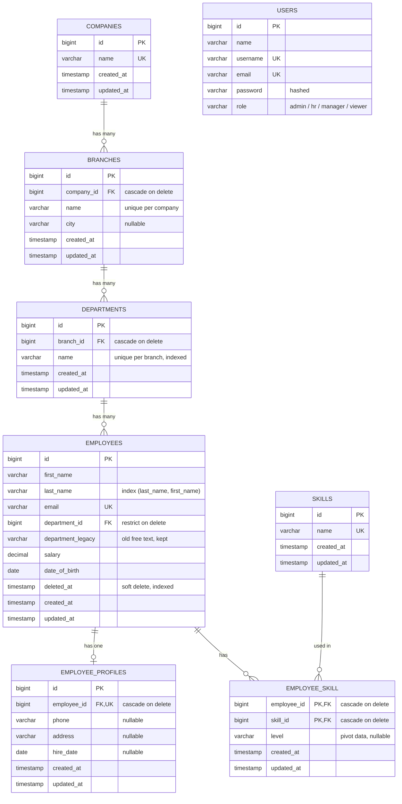

# ER Diagram — Employee Management System

The database is **normalized**: every fact is stored once, and tables point to each other with
**foreign keys** (FK) instead of repeating text. A company has branches, a branch has departments,
and a department has employees. An employee has one profile and many skills.

`USERS` (the people who log in) is separate from `EMPLOYEES` (the records being managed), so it has
no relationship lines.

## Relationships

| # | Relationship | Type | Foreign key | On delete | Eloquent (both sides) | Why |
|---|---|---|---|---|---|---|
| 1 | Company → Branches | one-to-many | `branches.company_id` → `companies.id` | **cascade** | `Company::branches()` **hasMany**, `Branch::company()` **belongsTo** | A branch can't exist without its company, so deleting a company deletes its branches. |
| 2 | Branch → Departments | one-to-many | `departments.branch_id` → `branches.id` | **cascade** | `Branch::departments()` **hasMany**, `Department::branch()` **belongsTo** | A department belongs to exactly one branch. Deleting a branch deletes its departments, but only if none of them has employees (see 3). |
| 3 | Department → Employees | one-to-many | `employees.department_id` → `departments.id` | **restrict** | `Department::employees()` **hasMany**, `Employee::department()` **belongsTo** | Replaces the old free-text `department`. *Restrict* protects data: the database refuses to delete a department that still has employees, including employees in the trash. |
| 4 | Employee → Profile | one-to-one | `employee_profiles.employee_id` (**unique**) → `employees.id` | **cascade** | `Employee::profile()` **hasOne**, `EmployeeProfile::employee()` **belongsTo** | Optional contact and employment details live in their own table. `unique` makes it one-to-one. Permanently deleting the employee deletes the profile. |
| 5 | Employee ↔ Skills | many-to-many | pivot `employee_skill` (`employee_id`, `skill_id`, composite primary key) | **cascade** (both) | `Employee::skills()` **belongsToMany**, `Skill::employees()` **belongsToMany** (`withPivot('level')->withTimestamps()`) | An employee has many skills and a skill belongs to many employees. A many-to-many needs a third (pivot) table, which can also hold extra data such as `level`. |
| 6 | Branch → Employees | has-many-through | through `departments` | — | `Branch::employees()` **hasManyThrough** | Lists everyone in a branch without a `branch_id` on employees (that would duplicate data). |

## Indexes and keys

- **PK** (primary key): `id` on every table. On the pivot table, the composite `(employee_id, skill_id)` also stops the same skill being attached twice.
- **FK** columns created with `foreignId()->constrained()` get an index automatically, so joins are fast.
- **Unique** (UK): `companies.name`, `(company_id, name)` on branches, `(branch_id, name)` on departments, `skills.name`, `employees.email`, `employee_profiles.employee_id`, `users.username`, `users.email`.
- **Extra indexes:** `departments.name`, `employees (last_name, first_name)` for search and sort, and `employees.deleted_at` for the trash filter.

## Soft deletes

`employees.deleted_at` is `NULL` for active employees. "Delete" in the app only fills it in (`SoftDeletes`), so the employee moves to the **trash**:

- Normal queries (`Employee::all()`, `$department->employees`, `withCount`) automatically skip trashed rows.
- `Employee::onlyTrashed()` lists the trash, `restore()` brings an employee back, and `forceDelete()` removes the row for good. Only then do the `cascade` rules remove the profile and skill links.
- The row still exists while in the trash, so its email stays taken (unique), and its department still can't be deleted (restrict).

## Migration from the old schema

Before this change, `employees.department` was free text (e.g. "Sales"). The migration
`2026_10_19_000005_add_department_id_to_employees_table`:

1. adds `employees.department_id` (FK, restrict),
2. creates **Default Company → Head Office**, plus one department for each distinct old text value,
3. fills `department_id` for every existing employee,
4. keeps the old text, renamed to **`department_legacy`**. That frees the name `department` for the Eloquent relationship. `department_legacy` can be dropped later.
